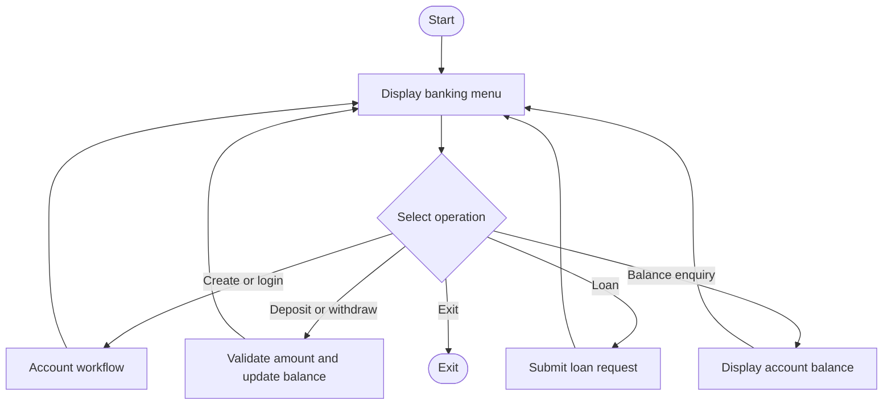

# Bank Management System with Loan Facility

**Educational, console-based banking workflow simulation built with Python.**

This project demonstrates basic account and loan workflows through a menu-driven command-line interface.

## Features described by the project

- Account creation and login
- Deposits and withdrawals
- Balance enquiry
- Loan application submission and status display
- Input validation and menu-driven interaction

## Technology

Python 3 · Functions · Dictionaries · Loops · Conditional logic · Exception handling

## Run locally

```bash
git clone https://github.com/kirubanandhan016/Bank-Management-System-with-Loan-Facility.git
cd Bank-Management-System-with-Loan-Facility
python bank.py
```

If your local source file has a different name, use that filename when running Python.

## Current limitations

This is an educational simulation, not a real banking application. Account data is stored in memory and is lost when the program exits. Do not use real banking credentials or financial information. The loan workflow is a demonstration and should not be treated as a real credit decision process.

## Possible next improvements

- Persistent storage with SQLite
- Unit tests for deposits, withdrawals, and balance invariants
- Salted PBKDF2-HMAC-SHA256 hashing for the demo account PINs
- Transaction history
- Explicit loan approval and repayment states

## Author

**Kirubanandhan V** · [GitHub](https://github.com/kirubanandhan016)


## Application flow



## Important scope and verification

This is a local learning simulation. It does not provide persistent, auditable financial transactions, secure production identity management, or a real credit decision process. Use synthetic test data only. Validate that deposits and withdrawals reject non-positive amounts and that withdrawals cannot make an account balance negative.

